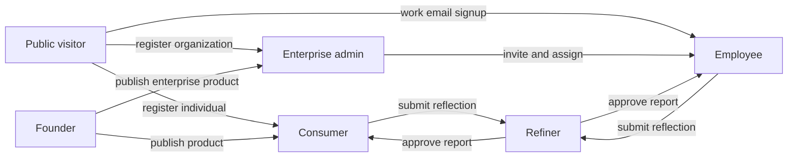
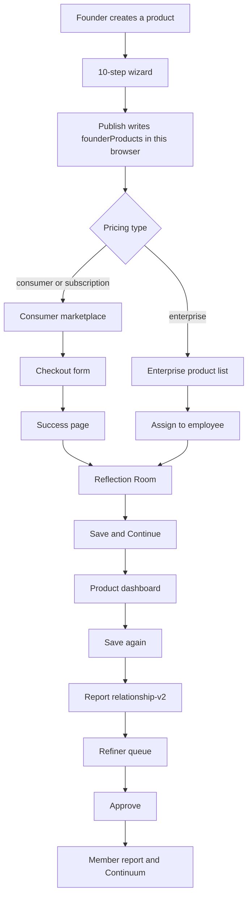
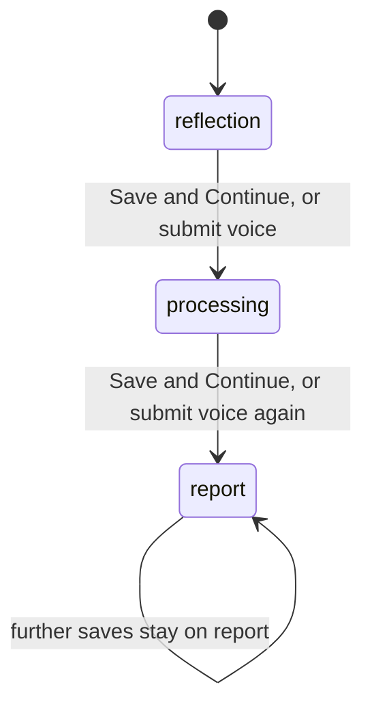
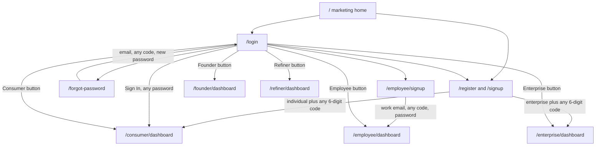
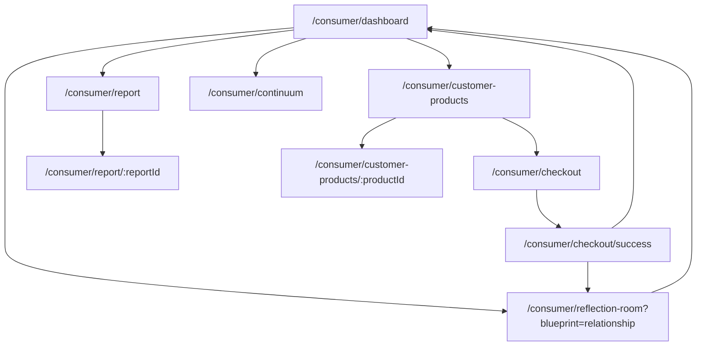
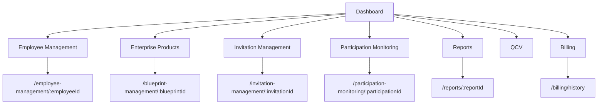
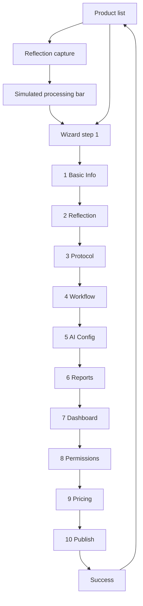
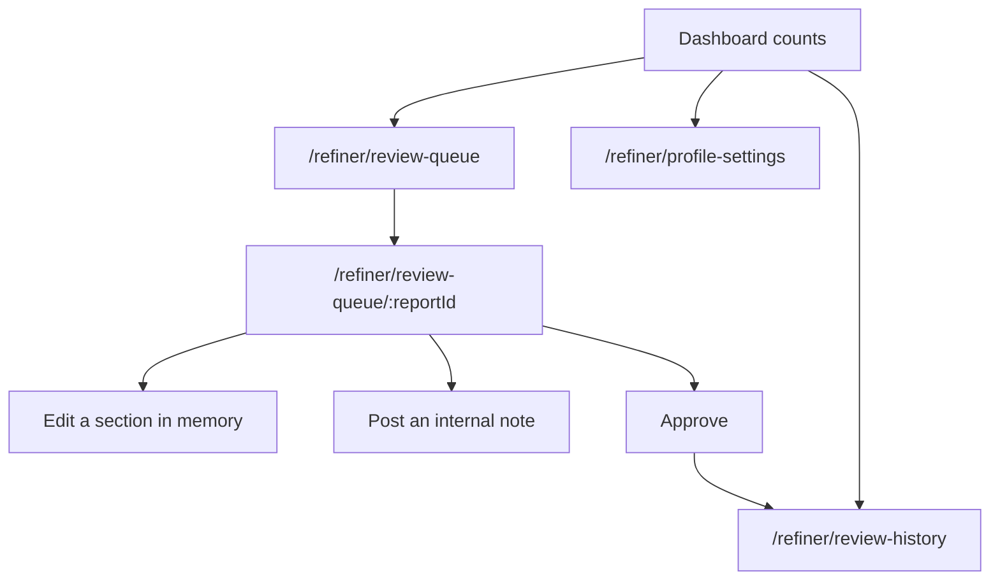

# FAR frontend — end-to-end user flow

This file describes the app as it runs today. It is a static React frontend. Screens, buttons, and demo records are real. A server, database, payment processor, email sender, and AI processor are not connected.

Use this as the map for a backend. Where a button only shows a toast or writes browser storage, that is called out. A backend must own that step before the same button can be treated as production behavior.

## 1. Runtime truth

| Fact | What the code does |
| --- | --- |
| Stack | React 19, TypeScript, Vite, Tailwind, Redux Toolkit, redux-persist, React Router |
| API base | `VITE_API_BASE_URL` is read in `src/store/Api/BaseApi/BaseApi.ts` and is unset. No request leaves the browser from the screens. |
| Auth client | `POST /user/signin`, `POST /user/signup`, `POST user/refreshToken`, `GET/PUT /user/profile/:id` are defined and unused. Login, register, and password reset never call them. |
| Route guards | `ProtectedRoute` exists and would require `auth.user.role === "admin"`. It is not mounted. Every portal URL opens without a session. |
| Login result | The sign-in form waits one second, toasts success, and always opens `/consumer/dashboard`. It does not store a user or a token. |
| What survives refresh | `auth` (localStorage key `persist:root`) and `memberJourney` (key `persist:memberJourney`). Product, widget, protocol, user, and enterprise edits die on refresh. |
| Audio | Reflection recordings stay in the browser as an object URL. They are not uploaded. |

Demo people painted into the UI, not loaded from a session:

| Surface | Person |
| --- | --- |
| Consumer sidebar | Liza Fernandes, role Consumer |
| Employee sidebar and profile | Sarah Johnson, Project Manager, ABC Healthcare, `s.johnson@abchealth.com` |
| Founder product publish | stored `publishedBy: "Mike D."` |
| Refiner | Masud J, role Refiner |
| Enterprise | organization demo records in each page's local `data.ts` |

## 2. Actors



Founder User Management also names four assignable roles: `Enterprise Admin`, `Founder / Admin`, `Employee`, `Consumer`. Status values there are `Active`, `Invited`, `Suspended`. The Refiner is a fifth portal and is not one of those four roles. There is no routed Admin portal. Files under `src/pages/Admin/` are unused.

## 3. Cross-role product lifecycle

This is the business path the screens imply. Today only the Founder publish step and the member Continue step write Redux. The arrows between roles are not wired to each other.



What a backend must store for that path:

1. Product, including the ten wizard sections and a dashboard layout.
2. Who can buy it, who it is assigned to, and the price type: consumer, subscription, or enterprise.
3. Purchase or license, separate from the reflection.
4. Reflection session: mode, language, audio or text, vibe, timestamps.
5. Processing job that turns a submitted reflection into insight.
6. Report versions, and a refiner decision on the current version.
7. Continuum history across cycles of the same product.

## 4. Two journey models that are not the same

The consumer dashboard shows six circles. Continue uses a different three-stop path. They do not update each other.

### 4.1 Painted tracker

`JourneyTracker` is display only. The circles are not links. Changing the product dropdown repaints a hardcoded stage.

| Product | Current circle | Status text | Expected completion |
| --- | --- | --- | --- |
| Relationship | 3 Reflection Submitted | Reflection submitted · awaiting insight | Nov 4, 2026 |
| Leadership | 2 Reflection Room | In the Reflection Room · ~25 mins remaining | Nov 18, 2026 |
| Executive Function & Clarity | 4 Illumination Bridge | In processing · ~12 mins remaining | Oct 28, 2026 |
| Personal Values | 5 Report / Dashboard | Report ready | Oct 12, 2026 |

Circle 6, Continuum, is never the current step for these four products. Continuum is a separate sidebar page.

Step labels, in order:

1. Product Selected — Your journey is ready to begin.
2. Reflection Room — Your guided reflection is underway.
3. Reflection Submitted — Your reflection has been received.
4. Illumination Bridge — Transforming reflection into personalized insight.
5. Report / Dashboard or other external output — Your personalized report is available.
6. Continuum — Your path forward remains open.

### 4.2 Clickable Continue path

`memberJourney.stages` is a map of product id to `reflection | processing | report`. Seeded ids are `relationship`, `leadership`, and `PRD-001`, all starting at `reflection`. This map is kept in localStorage.

```text
continuePath(base, id, stage):
  if stage is report      -> {base}/report/relationship-v2
  if stage is processing  -> {base}/customer-products/{id}
  else                    -> {base}/reflection-room?blueprint={id}
```

`base` is `/consumer` or `/employee`.

```text
saveJourney(blueprintId):
  if this room is the Founder product-creation preview, do nothing
  current = stages[blueprintId] or "reflection"
  if current is reflection -> set processing
  else                     -> set report
```

Save & Continue and the voice submit action both call `saveJourney`, then leave the room and open the member dashboard. They do not open the next stage themselves. The next Continue click reads the new stage.



Backend note: the report stop always opens the id `relationship-v2`, even when the blueprint id is `leadership` or `PRD-001`. A real API should open the report that belongs to that assignment.

## 5. Public site and account entry



Navbar links that have no route, so they render Not Found:

- `/solutions/individual`
- `/solutions/organization`
- `/platform`
- `/about`
- `/pricing`
- `/resources/blog`
- `/resources/docs`
- `/resources/support`

`/form` is a dynamic-form demo and is not part of a user journey.

### 5.1 Register fields

Individual: name, email, password. Then a 6-digit code. Any complete code is accepted. No email is sent.

Enterprise: organization name, business email, password, organization size, country. Then the same fake code. Lands on the enterprise dashboard.

### 5.2 Employee signup

1. Work email. Format is checked. No invitation token is checked.
2. Any 6-digit code.
3. Password of at least 8 characters.
4. Opens `/employee/dashboard`.

### 5.3 Forgot password

1. Email, non-empty.
2. Any 6-digit code.
3. New password, at least 8 characters, must match the confirmation.
4. Returns to `/login`. The password is not stored.

Google and Apple buttons on login do nothing.

## 6. Consumer

Sidebar: Dashboard, Consumer Products, Reflection Room, Reports, Continuum. Profile and notifications are header destinations.



`/consumer` redirects to `/consumer/dashboard`. `/consumer/blueprint` redirects to `/consumer/customer-products`.

### 6.1 Dashboard

Blocks, top to bottom:

1. Journey tracker. Dropdown only. See section 4.1.
2. Active reflection card. Continue uses the `relationship` stage from section 4.2. Explore Library opens the marketplace.
3. Recommended item, recent activity, completed reports, quick actions. These link to the marketplace, a report, or the reflection room. They do not change the six circles.

### 6.2 Marketplace and checkout

Marketplace cards open `/consumer/checkout` with no product id. Checkout is a fixed FuturePath Blueprint form: name, email, card number, expiry, CVC, cardholder. Submit always opens the success page. Nothing is charged and nothing is added to `memberJourney`.

Success offers Start Reflection (`/consumer/reflection-room` with no blueprint query), Go to Dashboard, and View All Products.

An active-reflection card on a product page uses Continue for that product id. Unknown ids start at `reflection`.

### 6.3 Reflection Room

Shared by Consumer, Employee, and the Founder product wizard. Member mode reads `?blueprint=`. Default id is `relationship`.

```text
inputMode: voice | type
language: en | es
phase: idle -> recording -> paused -> recorded -> submitted
vibe: Calm | Focus | Night     stored in memberJourney
```

Voice controls: record, pause, resume, stop, replay, re-record. Type mode shows the prompt "A moment of stillness" in English and "Un momento de quietud" in Spanish. End Session leaves for the dashboard without `saveJourney`. Save & Continue and voice submit call `saveJourney` and then also leave for the dashboard.

Music / Vibe writes `memberJourney.vibe`. The branding modal exists only in Founder product-creation mode.

### 6.4 Product dashboard

`/consumer/customer-products/:productId` renders the shared product dashboard view. In this demo it shows the layout stored on a founder product when that id exists in memory. It is the middle stop of Continue.

### 6.5 Reports

The list is static. Open a row at `/consumer/report/:reportId`. The seeded detail target is `relationship-v2`.

On the detail page:

- Version history is two static versions: V2 March 15 2026, V1 January 12 2026.
- Download PDF toasts that a PDF was queued. No file is created.
- Share copies the page location.
- Music / Vibe buttons write the same `memberJourney.vibe` as the room.

### 6.6 Continuum

`/consumer/continuum` is the FRC Continuum page. It is not step 6 of Continue. Continue My Reflection opens the reflection room.

### 6.7 Profile and notifications

Profile edit, password, and save are on-page only. Save toasts "Profile saved on this device." Consumer profile stays the individual demo. The organization block is hidden unless the role is employee.

Notifications can be filtered by All, Action Required, Blueprint Updates, Organization, and System. Filtering is local. A total count is the length of the demo list.

## 7. Employee

Same shell as Consumer, with `basePath` `/employee`. Sidebar label for products is Blueprints.

| Path | Page | Difference from consumer |
| --- | --- | --- |
| `/employee/dashboard` | Sarah Johnson org dashboard | Assigned blueprint, in-processing copy, Continue Reflection via `relationship` stage |
| `/employee/customer-products` | My Blueprints | No prices. Featured Relationship blueprint. Continue uses `relationship` stage |
| `/employee/customer-products/:productId` | Shared product dashboard | Same component as consumer |
| `/employee/reflection-room` | Shared Reflection Room | Same save rules |
| `/employee/report` and `/employee/report/:reportId` | Shared reports | Same static reports |
| `/employee/continuum` | Professional Development Continuum | Sarah Johnson history, not the consumer FRC page |
| `/employee/checkout` and `/employee/checkout/success` | Shared checkout | Reachable, not part of the employee sidebar story |
| `/employee/profile` | Shared profile | Adds org block: department, employee number, manager |
| `/employee/notifications` | Shared notifications | Same filters |

Employee dashboard Load Full Journey only swaps visible demo labels. It does not write `memberJourney`.

Unused files `src/pages/Employee/Blueprint.tsx`, `ReflectionRoom.tsx`, `Report.tsx`, and `Continuum.tsx` are work-in-progress placeholders. The router does not use them.

## 8. Enterprise

`/enterprise` redirects to `/enterprise/dashboard`. Data lives in each feature's `data.ts` plus component state. Refresh restores the seed.



| Area | What the user can do in the demo | What a backend must do |
| --- | --- | --- |
| Dashboard | Read KPIs, active reflections, billing card, quick actions | Aggregate this org only |
| Employees | Add, edit, suspend, reactivate, remove. Assign Leadership Blueprint toasts success | Persist the person and the assignment |
| Products | Open a blueprint, toggle a purpose preview. Purchase toasts "Purchase recorded for this demo organization." | License the product to the org |
| Invitations | Create invites, copy a secure link, resend, cancel | Send email, store token, expire it, bind it to employee signup |
| Participation | Read stage, timeline, activity. Export toasts | Read live assignment progress. Do not show private reflection text |
| Reports | Open a report, toast a PDF download | Generate the org report the role is allowed to see |
| QCV | Comparison controls, mark notices read. Organizational Culture Blueprint links to blueprint management | Serve org metrics |
| Billing | Upgrade toasts that the plan is already active. Renewal, invoice download, and email are toasts. History is a static invoice list | Subscription, invoices, receipts |
| Profile | Tabs for account, security, notifications, sessions. Saves toast | Real profile and session revocation |
| Notifications | Filter and mark one row read in memory | Per-user inbox |

Employee signup in section 5.2 does not read an invitation token. Wiring those two screens is required backend work.

## 9. Founder

`/founder` redirects to `/founder/dashboard`. This is the authoring portal.

Sidebar groups:

- Manage: Create Product, Widget Library, Protocol Library, User Management
- Operate: Reports, AI Services, Link Center, Analytics & Insights, Financial Center

Profile and notifications are routes without sidebar items: `/founder/profile`, `/founder/notifications`.

### 9.1 Create Product

List, then one of these views: `reflect`, `processing`, `wizard`, `success`.



Publish writes one product into `founderProducts` with status Published, a generated or typed id, division Consumer Products or Enterprise from the pricing type, and the dashboard draft. That slice is not persisted. Refresh drops the new product.

Step 3 reuses the Reflection Room in product-creation mode. Branding edited there is stored in `memberJourney.branding` and does survive refresh. The product itself does not.

After publish, related routes:

- `/founder/create-product/:productId` product details
- `/founder/create-product/:productId/dashboard` dashboard builder
- `/founder/create-product/:productId/dashboard/preview` member preview

The builder reorders widgets by drag or by Up/Down. The new order is in `founderProducts` until refresh.

Permission columns on step 8 are Editing, Dashboard, Reports, Analytics. The member portals do not enforce them.

AI provider names on step 5 are GPT-4, Gemini, and Claude. They are form options. No provider is called.

### 9.2 Widget Library

`/founder/widget-library` lists widgets from `founderWidgets`. Create opens `/founder/widget-library/create`. A row opens `/founder/widget-library/:widgetId`, and edit opens `.../edit`. Widgets are the pieces a product dashboard can place. They are not persisted.

### 9.3 Protocol Library

Local list. The user can filter by category, create a protocol, import one, duplicate a row, and archive a row. Archive sets that row to Draft and toasts. Nothing is saved for a second visit.

### 9.4 User Management

`/founder/user-management` and `/founder/user-management/:userId`. Roles and statuses are in section 2. Invite, edit, and permission changes are demo state.

### 9.5 Operate pages

| Page | Routes | Demo behavior |
| --- | --- | --- |
| Reports | `/founder/reports`, `/founder/reports/templates` | Template list and report records in `founderReports` |
| AI Services | `/founder/ai-services`, `/founder/ai-services/create-new-prompt` | Category filter, pause or reconnect a provider, copy a masked demo key |
| Link Center | `/founder/link-center`, `/founder/link-center/create` | Create a link record in page state |
| Analytics | `/founder/analytics-insights` | Static charts |
| Financial Center | `/founder/financial-center`, `.../invoices`, `.../invoices/:invoiceId` | Static invoices |
| Notifications | `/founder/notifications` | Local list |
| Profile | `/founder/profile` | Local profile form |

## 10. Refiner

`/refiner` redirects to `/refiner/dashboard`. Seeded reviewer is Masud J.



Queue statuses in the seed are `Needs Review`, `In Review`, and `Completed`.

Approve toasts "Report approved. Final PDF generating." and opens review history. No PDF is generated and the member's report screen does not change.

Profile settings can edit the local profile, change a local password, and replace a local photo. Those writes are not the `memberJourney` store.

Refresh queue, export PDF, and notification toggles are toasts.

## 11. Route catalog

### Account

| Method | Path | Result |
| --- | --- | --- |
| GET | `/` | Marketing home |
| GET | `/login` | Sign in, plus five portal shortcuts |
| GET | `/register`, `/signup` | Individual or enterprise registration |
| GET | `/forgot-password` | Three-step reset |
| GET | `/employee/signup` | Work-email signup |
| GET | `/form` | Form demo |
| GET | `*` | Not found |

### Consumer, prefix `/consumer`

`dashboard`, `customer-products`, `customer-products/:productId`, `blueprint` (redirect), `checkout`, `checkout/success`, `reflection-room`, `report`, `report/:reportId`, `continuum`, `profile`, `notifications`.

### Employee, prefix `/employee`

Same path list. `customer-products` renders My Blueprints. `continuum` renders the employee continuum. `dashboard` renders the employee dashboard.

### Enterprise, prefix `/enterprise`

`dashboard`, `employee-management`, `employee-management/:employeeId`, `blueprint-management`, `blueprint-management/:blueprintId`, `invitation-management`, `invitation-management/:invitationId`, `participation-monitoring`, `participation-monitoring/:participationId`, `reports`, `reports/:reportId`, `qcv`, `billing`, `billing/history`, `notifications`, `profile`.

### Founder, prefix `/founder`

`dashboard`, `create-product`, `create-product/:productId`, `create-product/:productId/dashboard`, `create-product/:productId/dashboard/preview`, `widget-library`, `widget-library/create`, `widget-library/:widgetId`, `widget-library/:widgetId/edit`, `protocol-library`, `user-management`, `user-management/:userId`, `reports`, `reports/templates`, `ai-services`, `ai-services/create-new-prompt`, `link-center`, `link-center/create`, `analytics-insights`, `financial-center`, `financial-center/invoices`, `financial-center/invoices/:invoiceId`, `profile`, `notifications`.

### Refiner, prefix `/refiner`

`dashboard`, `review-queue`, `review-queue/:reportId`, `review-history`, `profile-settings`.

## 12. Backend state machines

These are the machines the screens already assume. The frontend only implements the member one, and only inside one browser.

### Account

```text
anonymous
  -> pending_verification   register, employee signup, or forgot password
  -> active                 code accepted
active -> invited           founder or enterprise invite
invited -> active           employee signup bound to that invite
active -> suspended         founder or enterprise suspend
suspended -> active         reactivate
```

### Product

```text
draft -> published -> archived
```

Publish is the only transition the Founder screen performs, and it lasts until refresh.

### Assignment

One assignment is one person plus one product.

```text
selected
  -> reflection_in_progress
  -> reflection_submitted
  -> illumination_processing
  -> report_ready
  -> continuum_open
```

The six labels in section 4.1 are this machine. The three Continue values are a coarser version:

| Continue value | Assignment states it stands in for |
| --- | --- |
| `reflection` | selected, reflection_in_progress |
| `processing` | reflection_submitted, illumination_processing |
| `report` | report_ready, continuum_open |

### Refiner decision

```text
needs_review -> in_review -> approved
                           -> changes_requested
```

The screen only performs the approve jump, and it does not write the member report.

### Billing

```text
checkout_started -> payment_captured -> entitled
enterprise_license -> assigned_seats
invoice: open -> paid | void
```

Checkout currently skips payment and entitlement.

## 13. Data the backend owns

Minimum records, using names already present in the UI:

- User: id, email, role, status, verification, organization, timezone.
- Organization: enterprise account, plan, seats.
- Invitation: email, product, token, status, expiry.
- Product: wizard draft, version, division, price type, status, dashboard layout, permissions.
- Widget and protocol libraries, referenced by products.
- Assignment: user, product, coarse stage, fine stage, expected completion.
- Reflection session: blueprint id, mode, language, vibe, audio or text, submitted at.
- Report: id, assignment, versions, refiner status.
- Notification: user, tag, read flag.
- Invoice and subscription, per organization.
- AI provider config and prompts, per founder. Calls to a model are a later phase, not this frontend.

Isolation rule: an enterprise user sees org participation and reports, not the private text of an employee's reflection, unless a permission flag on that product says otherwise. The flags exist on the Founder form and are not enforced.

## 14. What is already local, and what is still absent

Already implemented in the browser:

- Continue stage for `relationship`, `leadership`, and `PRD-001`, kept after refresh on this device.
- Employee dashboard, My Blueprints, and employee continuum as demo screens.
- Reflection Room voice, type, language, vibe, replay, re-record, and product branding.
- Founder publish and widget reorder until refresh.
- Enterprise, refiner, protocol, and AI buttons that toast or edit local state.

Still absent, so a backend cannot be inferred from a working request:

- Sign-in does not create a session. Portal URLs are public.
- Register, employee signup, and password reset accept any 6-digit code and send no email.
- Checkout captures no payment and grants no entitlement.
- The six-circle tracker never moves.
- Report stage always opens `relationship-v2`.
- Audio never leaves the browser.
- Founder products, widgets, protocols, users, and enterprise records do not survive refresh.
- Refiner approval does not publish a report to the member.
- Invitation links are not required by employee signup.
- Marketing links in the navbar have no pages.
- Admin screens under `src/pages/Admin/` have no routes.
- The defined `/user/signin`, `/user/signup`, refresh, and profile endpoints are not called.
